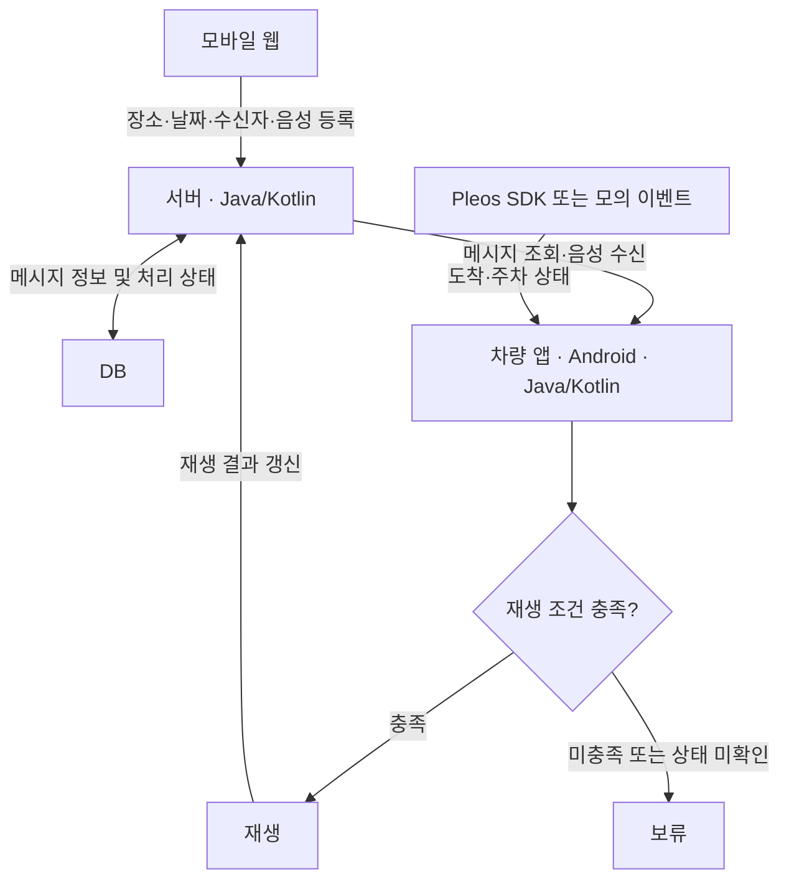

# 말뚝 2.0 (MalTtuk 2.0)

**장소와 시간에 맞춰 차량에서 듣는 음성 메시지**

말뚝 2.0은 발신자가 모바일 웹에서 장소, 날짜, 수신자를 지정해 음성을 남기고, 수신자가 차량 앱에서 메시지를 받아 재생하는 프로젝트입니다. 차량의 도착 및 주차 상태를 재생 조건에 반영하는 것을 목표로 합니다.

**핵심 흐름** `등록 → 수신 → 차량 상태 확인 → 재생 또는 보류`

휴대폰·차량 **React UI 원본 및 실행 방법**은 [apps/web/README.md](apps/web/README.md)를 확인하세요. 휴대폰 화면은 `apps/web/src/pages/`, 차량 시연 화면은 `apps/web/src/vehicle/pages/`에 나뉘어 있습니다. 이 브라우저 UI에는 release APK가 포함되지 않습니다.

**현재 상태** 저장소 및 개발 환경 구성 단계입니다. 아래 기능은 프로토타입 목표이며, 실제 차량 신호 지원과 차량 스피커 재생은 검증 예정입니다.

## 1. 문제 정의

발신자가 특정 장소와 관련된 음성 메시지를 남겨도, 일반 메시지에서는 수신자가 그 장소에 도착했는지 또는 지금 재생할 수 있는 상태인지 알기 어렵습니다. 말뚝 2.0은 메시지에 지정된 조건과 차량 상태를 연결해, 수신자가 차량에서 적절한 때에 음성을 들을 수 있는 흐름을 검증합니다.

## 2. 개발 목표

| 영역 | 1차 프로토타입 범위 |
| --- | --- |
| 모바일 웹 | 장소·날짜·수신자 선택, 음성 녹음 또는 파일 첨부, 미리 듣기와 등록 |
| 서버·DB | 메시지 등록·조회, 음성 업로드·다운로드, 재생 결과 갱신 규격 협의 |
| 차량 앱 | 메시지 목록·상세, 파일 수신, 재생·건너뛰기·중복 재생 방지 |
| 차량 상태 | Pleos SDK 지원 신호와 권한 확인, 도착·주차 상태 전달, 모의 이벤트 분리 |
| 통합 검증 | 음성 등록부터 차량 재생까지 확인하고, 재생 실패·보류·중복과 APK 설치를 검증 |

## 3. 시스템 흐름



예를 들어 발신자가 주차장 도착 후 들을 안내를 녹음해 등록합니다. 차량 앱이 메시지를 조회한 뒤, 합의된 도착·주차 조건을 확인하면 재생할 수 있습니다. 상태가 확인되지 않으면 보류하고, 동일 메시지가 다시 수신될 때 중복 재생을 막는지 검증합니다.

API 요청·응답, 음성 파일 형식, 차량 이벤트와 재생 허용 기준은 [연동 계약](docs/contracts/README.md)에서 협의합니다.

## 4. 팀과 기술 스택

| 담당 | 구현 및 검증 영역 | 기술 | 작업 위치 | 초기 브랜치 |
| --- | --- | --- | --- | --- |
| 나경 | 모바일 웹과 음성 등록 화면 | Java·Kotlin 기반 구성 협의 | [apps/web](apps/web/) | `feature/web-prototype` |
| 유림 | 메시지 API, 데이터 저장과 음성 송수신 | Java·Kotlin, DB | [services/api](services/api/) | `feature/backend-api` |
| 규혁 | 차량 화면, 음성 수신 및 재생 | Android, Java·Kotlin | [apps/vehicle](apps/vehicle/) | `feature/vehicle-playback` |
| 재민 | 차량 상태 신호, 권한 확인과 모의 이벤트 | Java·Kotlin, Pleos SDK | [apps/vehicle](apps/vehicle/) | `feature/pleos-integration` |
| 민석 | 통합 테스트, APK 빌드·설치, CI | GitHub Actions, Android 빌드 도구 | [tests/integration](tests/integration/), [docs](docs/) | `chore/integration-qa` |

차량 앱과 Pleos 연동은 하나의 Android 프로젝트를 공유합니다. 개발 언어는 Java·Kotlin을 기준으로 합니다. 모바일 웹 제공 방식, 서버 프레임워크, DB 엔진, JDK·Gradle 버전과 SDK 실행 환경은 팀에서 확인한 뒤 확정합니다.

## 5. 저장소 구조

```text
Hyundai-Project-MalTtuk/
├── apps/
│   ├── web/               # 모바일 웹
│   └── vehicle/           # 차량 앱과 Pleos 연동
├── services/api/          # 백엔드 API와 DB
├── tests/integration/     # 통합 테스트 시나리오
├── docs/contracts/        # API와 차량 이벤트 협의 항목
├── scripts/               # 저장소 기본 검사
├── .github/               # CI, PR 및 이슈 양식
├── .env.example           # 공유용 환경변수 예시
└── AGENTS.md              # 에이전트 작업 지침
```

## 6. 시작하기와 브랜치 운영

저장소를 연 뒤 초기 설정이 들어 있는 `develop` 브랜치에서 실행합니다. 원격에 `develop`이 게시되면 팀원도 해당 브랜치를 받아 시작할 수 있습니다.

```powershell
git switch develop
if (-not (Test-Path .env)) { Copy-Item .env.example .env }
python scripts/check_repository.py
```

`.env`는 각자 로컬에서 관리하고, 공유할 변수 이름은 `.env.example`에 기록합니다. 앱 실행 명령과 환경변수 연결 방식은 구현하면서 각 폴더의 README에 추가합니다. 현재 CI는 저장소 기본 규칙을 검사합니다. Python 명령은 이 검사 도구를 실행하는 데 쓰입니다. Gradle 프로젝트가 구성되면 Java·Kotlin 컴파일, 단위 테스트, Android Lint를 검사합니다. [검증 기준](docs/verification.md)

일반 작업은 담당 브랜치에서 시작하고 `develop`을 대상으로 PR을 엽니다. 통합 검증이 끝난 변경은 `develop`에서 `main`으로 PR을 올려 시연·제출 버전에 반영합니다. [협업 규칙](CONTRIBUTING.md)

## 7. 1차 일정과 완료 기준

| 날짜 | 목표 |
| --- | --- |
| 11/5 | 저장소와 공통 규격 정리, 역할별 화면·DB·SDK 환경 구성 |
| 11/6 | 역할별 프로토타입과 기획서 초안, 1차 연동 테스트, APK 빌드·설치 확인 |

**최종 완료 기준** 모바일 웹에서 등록한 음성을 차량 앱이 받아 차량 스피커로 재생하고, 재생 실패·보류·중복 시나리오의 결과를 기록합니다. 실제 차량 신호와 모의 이벤트의 결과를 구분하고, 설치 확인용 APK, 시연 자료와 기획서를 준비합니다.

## 8. 팀 문서

- [역할과 일정](docs/team.md)
- [API 및 차량 상태 연동 계약](docs/contracts/README.md)
- [통합 테스트 시나리오와 제출물](tests/integration/README.md)
- [에이전트 작업 지침](AGENTS.md)
- [보안과 데이터 처리](docs/security.md)
- [빌드 및 검증 기준](docs/verification.md)
- [작업 기록 양식](docs/work-log-template.md)
