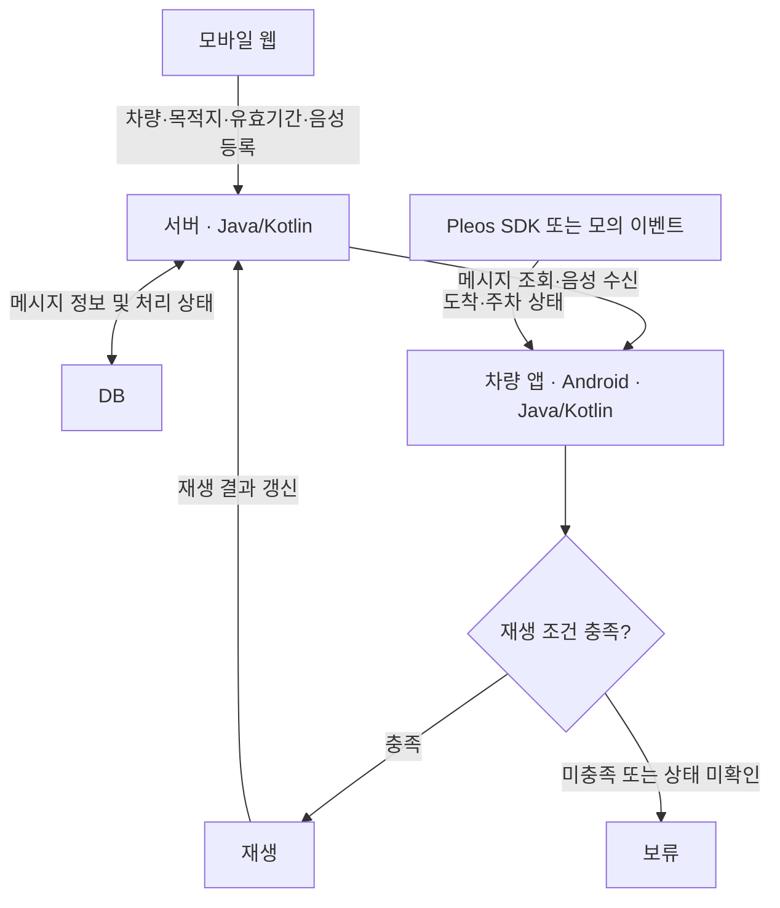

# 차마못한말 (chamamothanmal)

**장소와 시간에 맞춰 차량에서 듣는 음성 메시지**

차마못한말은 모바일 웹에서 친구로 연결한 운전자에게 목적지·수신 시작일·청취 모드를 지정해 음성을 보내고, 차량의 도착·주차 조건에 따라 재생하고 선택적으로 답장하는 프로젝트입니다. 현재 UI 연동은 [친구 메시지 계약](docs/contracts/friend-messages-mvp.md)을 따르며 기존 가족·차량 API는 별도로 보존합니다.

**핵심 흐름** `등록 → 수신 → 차량 상태 확인 → 재생 또는 보류`

**현재 상태** 로컬 계정·친구·웹 음성 전송과 차량 수신·완료·답장 API 연결을 구현했습니다. 자동 검사 및 HTTP 통합 시험과 실제 UI·SDK·스피커·원격 Supabase 검증을 구별합니다.

## 2026-11-13 친구 UI 통합

모바일 웹에서 로컬 운전자·녹음자 계정을 가입하고 ID/전화번호로 친구를 연결해 PCM WAV 음성을 전송합니다. 선택한 날짜부터 수신 가능하며 수신 가능 시점부터 24시간 뒤 만료됩니다. Android 시작 화면과 차량 브라우저 미리보기는 같은 친구 메시지 API로 조회·재생·완료·7일 보관·이모지 답장을 연결합니다. 차량 브라우저는 명시적 MOCK이며 실제 SDK·스피커 검증과 구별합니다. [실행 방법](apps/web/README.md), [계약](docs/contracts/friend-messages-mvp.md).

## 2026-11-11 추가 연결

서버 경유 [장소명·주소 검색](services/api/PLACE_SEARCH.md)과 선택 주소 저장을 추가했고, 조원의 차량 화면에 [서버 연결 시험 화면](apps/vehicle/android/SERVER_INTEGRATION.md)을 연결했습니다. 웹 UI 소스는 apps/web/src에 있으며 실제 카카오 검색은 개인 키 설정이 필요한 별도 검증 대상입니다. 실제 새 차량 화면·SDK·스피커 실행은 별도 확인합니다.

휴대폰·차량 **React UI 원본 및 실행 방법**은 [apps/web/README.md](apps/web/README.md)를 확인하세요. 휴대폰 코드는 `apps/web/src/mobile/`, 차량 UI 코드는 `apps/web/src/infotainment/`에 있습니다.

## 1. 문제 정의

발신자가 특정 장소와 관련된 음성 메시지를 남겨도, 일반 메시지에서는 수신자가 그 장소에 도착했는지 또는 지금 재생할 수 있는 상태인지 알기 어렵습니다. 차마못한말은 메시지에 지정된 조건과 차량 상태를 연결해, 수신자가 차량에서 적절한 때에 음성을 들을 수 있는 흐름을 검증합니다.

## 2. 개발 목표

| 영역 | 1차 프로토타입 범위 |
| --- | --- |
| 모바일 웹 | 차량·목적지·유효기간 선택, 음성 녹음 또는 파일 첨부, 미리 듣기와 등록 |
| 서버·DB | 메시지 등록·조회, 음성 업로드·다운로드, 재생 결과 갱신 규격 협의 |
| 차량 앱 | 메시지 목록·상세, 파일 수신, 재생·건너뛰기·중복 재생 방지 |
| 차량 상태 | Pleos SDK 지원 신호와 권한 확인, 도착·주차 상태 전달, 모의 이벤트 분리 |
| 통합 검증 | 음성 등록부터 차량 재생까지 확인하고, 재생 실패·보류·중복과 APK 설치를 검증 |

## 3. 시스템 흐름



예를 들어 발신자가 주차장 도착 후 들을 안내를 녹음해 등록합니다. 차량 앱이 메시지를 조회한 뒤, 합의된 도착·주차 조건을 확인하면 재생할 수 있습니다. 상태가 확인되지 않으면 보류하고, 동일 메시지가 다시 수신될 때 중복 재생을 막는지 검증합니다.

API 요청·응답, 음성 파일 형식, 차량 이벤트와 재생 허용 기준은 [연동 계약](docs/contracts/README.md)에서 협의합니다.

## 4. 팀과 기술 스택

| 담당 | 구현 및 검증 영역 | 기술 | 작업 위치 | 초기 브랜치 |
| --- | --- | --- | --- | --- |
| 나경 | 모바일 웹과 음성 등록 화면 | Java·Kotlin 기반 구성 협의 | [apps/web](apps/web/) | `feature/web-prototype` |
| 유림 | 메시지 API, 데이터 저장과 음성 송수신 | Java 17 호환 · Spring Boot · Gradle · local H2 / Supabase 연결 모드 | [services/api](services/api/) | `feature/backend-api` |
| 규혁 | 차량 화면, 음성 수신 및 재생 | Android, Java·Kotlin | [apps/vehicle](apps/vehicle/) | `feature/vehicle-playback` |
| 재민 | 차량 상태 신호, 권한 확인과 모의 이벤트 | Java·Kotlin, Pleos SDK | [apps/vehicle](apps/vehicle/) | `feature/pleos-integration` |
| 민석 | 통합 테스트, APK 빌드·설치, CI | GitHub Actions, Android 빌드 도구 | [tests/integration](tests/integration/), [docs](docs/) | `chore/integration-qa` |

차량 앱과 Pleos 연동은 하나의 Android 프로젝트를 공유합니다. 개발 언어는 Java·Kotlin을 기준으로 합니다. 서버는 Java·Spring Boot·Gradle이며 로컬 H2와 Supabase Auth·DB·Storage 연결 모드를 제공합니다. 실제 원격 연결은 별도 검증하며 실행은 [서버 README](services/api/README.md)를 따릅니다. 이는 통합 시험용 구현 선택이며 팀 전체의 최종 스택 합의를 대신하지 않습니다. 모바일 웹 제공 방식과 Android JDK·Gradle 버전·SDK 실행 환경은 별도로 확정합니다.

## 5. 저장소 구조

```text
Hyundai-Project-chamamothanmal/
├── apps/
│   ├── web/               # 모바일 웹
│   └── vehicle/           # 차량 앱과 Pleos 연동
├── services/api/          # 백엔드 API와 DB
├── tests/integration/     # 통합 테스트 시나리오
├── docs/contracts/        # API와 차량 이벤트 협의 항목
├── scripts/               # 저장소 기본 검사
├── .github/               # CI, PR 및 이슈 양식
├── .env.example           # 공유용 환경변수 예시
└── AGENTS.md              # 에이전트 작업 지침
```

## 6. 시작하기와 브랜치 운영

저장소를 연 뒤 초기 설정이 들어 있는 `develop` 브랜치에서 실행합니다. 원격에 `develop`이 게시되면 팀원도 해당 브랜치를 받아 시작할 수 있습니다.

```powershell
git switch develop
if (-not (Test-Path .env)) { Copy-Item .env.example .env }
python scripts/check_repository.py
```

`.env`는 각자 로컬에서 관리하고, 공유할 변수 이름은 `.env.example`에 기록합니다. 앱 실행 명령과 환경변수 연결 방식은 구현하면서 각 폴더의 README에 추가합니다. 현재 CI는 저장소 기본 규칙을 검사합니다. Python 명령은 이 검사 도구를 실행하는 데 쓰입니다. Gradle 프로젝트가 구성되면 Java·Kotlin 컴파일, 단위 테스트, Android Lint를 검사합니다. [검증 기준](docs/verification.md)

일반 작업은 담당 브랜치에서 시작하고 `develop`을 대상으로 PR을 엽니다. 통합 검증이 끝난 변경은 `develop`에서 `main`으로 PR을 올려 시연·제출 버전에 반영합니다. [협업 규칙](CONTRIBUTING.md)

## 7. 1차 일정과 완료 기준

| 날짜 | 목표 |
| --- | --- |
| 11/5 | 저장소와 공통 규격 정리, 역할별 화면·DB·SDK 환경 구성 |
| 11/6 | 역할별 프로토타입과 기획서 초안, 1차 연동 테스트, APK 빌드·설치 확인 |

**최종 완료 기준** 모바일 웹에서 등록한 음성을 차량 앱이 받아 차량 스피커로 재생하고, 재생 실패·보류·중복 시나리오의 결과를 기록합니다. 실제 차량 신호와 모의 이벤트의 결과를 구분하고, 설치 확인용 APK, 시연 자료와 기획서를 준비합니다.

## 8. 팀 문서

- [역할과 일정](docs/team.md)
- [API 및 차량 상태 연동 계약](docs/contracts/README.md)
- [통합 테스트 시나리오와 제출물](tests/integration/README.md)
- [에이전트 작업 지침](AGENTS.md)
- [보안과 데이터 처리](docs/security.md)
- [빌드 및 검증 기준](docs/verification.md)
- [작업 기록 양식](docs/work-log-template.md)

## 공모전 제출 APK 및 실행 안내 (2026-11-15)

### 제출 파일
- APK: [Ttotabolka_chamamothanmal_release.apk](apk/Ttotabolka_chamamothanmal_release.apk)
- 보조 다운로드: [GitHub Release v0.1.0-contest](https://github.com/MIDES2/Hyundai-Project-chamamothanmal/releases/tag/v0.1.0-contest)
- APK SHA-256: `F42DDBB90CC9CDE2C59969796322B9814478A47A9C03A933ADA2D6229CD2C8CC`
- 서명된 release APK이며 설치·실행과 서명 검증을 확인했습니다.

### 테스트 환경
- Windows 11 / Android Studio
- Pleos Connect 에뮬레이터 2.1.0
- Android 14 / API 34 / x86_64
- 에뮬레이터 화면 해상도: 2560 × 1440
- 앱 패키지: `com.example.malttuk`

### 실행 방법
1. 에뮬레이터에 제출 APK를 설치하고 차마못한말 앱을 실행합니다.
2. 발신자 웹 주소에 접속합니다: https://hyundai-project-chamamothanmal.onrender.com
3. 웹에서 운전자 계정과 녹음자 계정을 각각 가입합니다.
4. 녹음자 계정으로 로그인하고 운전자 ID 또는 전화번호로 친구를 연결합니다.
5. 차량 앱의 로그인 화면에서 서버 주소 설정을 열고 아래 주소를 입력합니다.
   `https://hyundai-project-chamamothanmal.onrender.com`
6. 차량 앱에는 운전자 계정으로 로그인합니다.
7. 발신자 웹에서 음성을 녹음하고 장소 좌표·수신 시작일·청취 모드·전달 대상을 지정해 등록합니다.
8. 차량 앱에서 받은 마음을 새로고침하고 메시지를 선택합니다.
9. 목적지 도착·P단·도어 닫힘 등 재생 조건을 충족하면 청취 모드에 따라 재생합니다.

배포 서버를 사용하는 경우 PC에서 로컬 API 서버나 웹 개발 서버를 별도로 실행할 필요가 없습니다. 차량 앱을 다시 실행한 뒤에는 서버 주소를 확인해 주세요.

### 에뮬레이터 도착 재현
시험 메시지의 목적지를 위도 `37.0000`, 경도 `127.0000`으로 등록한 경우 다음 명령으로 위치를 전달할 수 있습니다. 명령의 좌표 순서는 경도, 위도입니다.

```powershell
& "$env:LOCALAPPDATA\Android\Sdk\platform-tools\adb.exe" -s emulator-5554 emu geo fix 127.0000 37.0000
```

위 명령은 에뮬레이터의 GPS 위치를 주입하는 시험입니다. 실제 차량에서의 도착 시험과 구별합니다. P단과 도어 상태 등 다른 재생 조건도 충족해야 합니다.

### 확인한 동작과 범위
- HTTPS 서버를 통한 로그인, 친구 연결, 음성 등록 및 차량 메시지 조회
- 목적지 범위 밖에서 재생 보류
- 에뮬레이터 GPS로 도착을 재현한 자동 재생
- ‘재생 전 확인’ 모드에서 듣기 버튼을 눌렀을 때만 재생
- 재생 완료 후 차량 보관함 이동 및 발신자 완료 표시
- 실제 차량에서의 동작은 미검증
- 배포 서버 재시작 후 계정·음성 파일 유지 여부는 별도 확인 필요